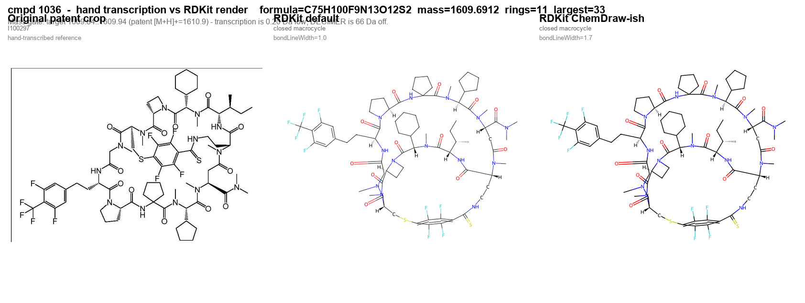
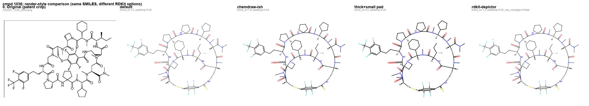

# Progress report — cyclic-peptide OCSR pipeline

**Dataset:** WO2025162428 golden tables (`PCTCN2025075389-ftappb-I100280...382.jpg`)
**Scope:** 406 compounds, cmpd 1001-2173 and 3001-3003
**Last updated:** 2026-10-29 (today's addendum at the top)





---

## 0c. 2026-10-29 (evening) — external validation: a compound the
## pipeline had never read

**The validated route was checked on compound 2173 — a compound the
pipeline has never managed to read — and it came back at edit
distance 1.**  A clean recogniser-only comparison was also added,
which explains the "upscaling made it worse" observation that came up
when these numbers were reviewed.

Full write-up: `data/audit/phase3/external/EXTERNAL_VALIDATION.md`.

### Compound 2173, on a page never used for tuning

Compound 2173 sits on patent page I100376 (= PDF page 240), which was
never part of the configuration search.  In the shipped CSV its
`smiles` is a bracket-less string and its `smiles_best` is **empty** —
the pipeline had no usable structure for it at all.

Its printed SMILES was re-read from the golden table line by line at
3x (eight evidence images, `data/audit/phase3/external/evidence_2173/`),
and the two routes were compared against that transcription:

| source | length | edit vs reference | brackets |
|---|---:|---:|---|
| **validated route** | 282 | **1** | 38/38 |
| production route | 250 | 35 | 14/32 |
| shipped CSV `smiles` | 229 | 33 | 16/23 |
| DECIMER (from the drawing) | 237 | 18 | 34/34 |

The single error is a `C(=O)` read as `C(=0)` — the letter `O`
mistaken for the digit zero.  The 3x crop confirms the printed glyph
is a letter, so this is an OCR error, not a reference error.

This is a **text-level** result.  The reference is a transcription
awaiting a human check, exactly like the 1039-1041 references, and it
says nothing about whether the recovered *structure* is right.

### Corpus scale: the validated route over all 336 cells

| metric | validated route | production route (shipped CSV) |
|---|---:|---:|
| cells | 336 | 335 |
| bracket-balanced | **228** | **0** |
| all printed rows recovered | **336** | — |
| strict pass (balanced + rows + length 220-300) | 224 | 0 |
| cells with characters outside the SMILES alphabet | 62 | — |

Balanced brackets and complete rows are **text-level proxies, not
accuracy**.  They only say the string *looks like* a whole SMILES.

### A clean recogniser-only comparison

The earlier "upscaled vs not" probe changed the recogniser and the
preprocessing at the same time, which confounded it.  The new
comparison holds the crop geometry completely fixed — same ink bands,
same table rules trimmed, same padding, same 2x upscale, same
recognition-only mode — and swaps only the recogniser:

| | English PP-OCRv4 mobile (production) | default PP-OCRv6 small |
|---|---:|---:|
| bracket-balanced (of 336) | **2** | **228** |
| cells with illegal characters | 148 | 62 |
| total left brackets | 10434 | 12815 |
| total right brackets | 12863 | 12881 |

The English recogniser drops **2429 left brackets** across the corpus.
That is the direct cause of the 335/335 bracket imbalance in the
shipped CSV, and it has **nothing to do with the cropping**.

### Why "upscaling made it worse" — the mechanism

RapidOCR's recogniser is configured with `rec_img_shape: [3, 48, 320]`
and `ch_ppocr_rec/main.py::resize_norm_img` always normalises the text
strip to **48 px tall**:

```python
img_height = 48
resized_w  = ceil(img_height * w / h)
cv2.resize(img, (resized_w, img_height))

```

So the recogniser rescales whatever it is given.  A 30 px printed
band is padded to 54-62 px by the route, which is already above 48, so
the recogniser always *shrinks* it.  At scale 1 that is one
interpolation, on the recogniser's own sampling grid; at scale 2 we
first double the strip ourselves and the recogniser then shrinks it
again -- two interpolations, the second one on its grid, which is
where the two short bars of `=` and the ring of `@` get merged.

Upscaling therefore never gives the recogniser more information; it
only adds a resampling step.

Measured on the validated route's own crops, with only the scale
factor changing:

| cmpd | scale 1 | scale 2 | scale 3 |
|---|---|---|---|
| 1036 | edit 0 | edit 0 | edit 2 |
| 1037 | edit 3 | edit 3 | edit 6 |
| 2173 | brackets 38/**34** | brackets 38/**38** | brackets 38/38 |

Upscaling is therefore **not a resolution operation** — it is the
choice of whether the recogniser should do the rescaling.  The target
is 48 px and the extra interpolation costs detail, so upscaling is not
a systematic advantage: it does nothing on 1036 and 1037, it helps on
2173, and scale 3 is worse on both.  The honest summary is that
upscaling shifts the sampling phase; it does not add information.

### A second patent could not be downloaded

Every public mirror tried refused the request: Google Patents answers
503, the EPO publication server 500, Espacenet 403,
`patentimages.storage.googleapis.com` 403, USPTO `image-ppubs` 404.
The HTTP status of each attempt is recorded in
`data/audit/phase3/external/external_patent_search.json` and
`data/raw/_external_validation/fetch_WO2022234852.json`.

The source PDF was scanned for pages the golden set does not cover,
and there are none: the 270-page PDF's SMILES-bearing table pages are
exactly the 103 golden tables.  PDF page 240 was confirmed to *be*
golden table I100376, page 243 is a pure activity table and page 269
is the international search report.  Compound 2173 is therefore the
strongest generalisation test this patent can offer.

PubChem's PUG REST is reachable and was used as an independent
third-party reference; the patent compounds are not deposited there
yet, so it yields no conclusions either way and is recorded as such.

---

## 0b. Today (2026-10-29) — validated printed-SMILES route, and the
## right-edge bug that was breaking it

**A second, independent OCR route now reads the printed SMILES
column at character level, and the column geometry that feeds it had
a bug that had been hiding the route's real quality.**

* **New route (`src/cpd/ocr/printed_smiles.py`).** Two routes now
  coexist behind `--smiles-route {production,validated}`:

  | | `production` | `validated` |
  |---|---|---|
  | recogniser | English PP-OCRv4 mobile | upstream default (PP-OCRv6 rec) |
  | line segmentation | OCR detector boxes | our own ink-band projection |
  | crop geometry | trim to content, 2x upscale | trim table rules, pad each ink band |
  | cell column | fractional boundary | extended to the table's right rule |

  The `production` route is unchanged and still reproduces the shipped
  CSV byte for byte (15/15 compounds identical on pages I100297-300,
  CSV SHA256 unchanged).

* **The bug: a half-cut trailing glyph destroys the whole row.**
  On I100298 the printed SMILES of compound 1040 reaches page
  x = 1930, but the SMILES column stopped at x = 1925 -- the final
  glyph was sliced through the middle. The CTC recogniser does not
  return "the last character is damaged"; it returns garbage for the
  *entire* row (`CO()CC((.(C)` instead of
  `CCO[C@H]1CN2[C@@H](C1)C(=O)NC3(CC3)C(=`).

  Evidence chain, all in `data/audit/phase3/width_sensitivity/`:

  1. the phase-2 crop and the pipeline's crop are pixel-identical over
     their common columns; the pipeline crop is simply 20 px
     narrower (`crop_geometry.json`);
  2. 6 of 28 printed rows have ink cut off; 2 of them change their
     text, and both recover when the missing pixels are replaced by
     white padding -- which isolates the cause to the *cut glyph*
     rather than to the crop width (`glyph_cut.csv`);
  3. extending the cell to the table's right-hand rule (x = 1931)
     restores the full glyph (`rule_extension.csv`).

  The fix is `RapidOcrTableExtractor._widen_text_column_to_border`,
  and it applies to the `validated` route only.

* **Result on I100298** (1038 = researcher-supplied and held out of
  the configuration search; 1039-1041 = phase-3 transcriptions, still
  awaiting a human check):

  | cmpd | `production` edit | `validated` edit |
  |---|---|---|
  | 1038 | 35 | 1 |
  | 1039 | 33 | 1 |
  | 1040 | 39 | 0 |
  | 1041 | 37 | 0 |

  These are text-level numbers. They are not structure validation.

* **Negative results worth keeping.** Three plausible fixes were
  tested and *rejected* because they made things worse:
  normalising the strip to the recogniser's input height (edit 1 -> 3
  on 1038), rounding the width to a quantum (edit 1 -> 4), and
  splitting long rows into chunks (edit 1 -> 26). The recogniser is
  stable as long as it is handed a complete glyph; the geometry of
  the crop was the only thing that had to be fixed.
  (`experiments/phase3_geometry_fix.py`.)

* **Repository.** The 130+ scripts that had accumulated in the repo
  root are now in `experiments/` (one-off analysis) and `analysis/`
  (exploratory work); the loose figures moved to
  `data/audit/demos/`. `pytest` is now pinned to `tests/` so the
  vendored upstream clones under `references/` stop being collected.

## 0a. Today (2026-10-21)

**Two bugs fixed, one deliverable assembled.**

* **A* queue eviction was wrong.** The previous code called
  ``heapq.heappop`` to "drop the worst queued state", but ``heappop``
  drops the *cheapest* (most promising) state -- the exact opposite.
  Replaced with a mirrored lazy-eviction heap tracked alongside the
  frontier (``eviction_queue``) plus a ``live`` counter. Every
  operation stays O(log n); the worst states are now correctly
  discarded. (``src/cpd/mass_constrained_search.py``.)
* **The repair not running does not show up in the queue-cap bug.**
  Combined with the measured C(244,15) ~ 10^23 search space, real rows
  still hit ``time_budget_hit`` at 1.5 M states. Two-stage and
  state-dedup remain the next levers, not bigger budgets.
* **New: deterministic carbonyl rewrite.** OCR rings lost
  ``C(=O)`` 23/15 of the time as ``C-O)`` or ``C=O)``. Those anchors
  are unambiguous and recover 5 of the 6 substitutions without any
  search. (``src/cpd/ocr_rewrite.py``.)
* **New: polygonal-macrocycle renderer (ChemDraw-style ring).**
  Iterative pin-and-relax with ``AddFixedPoint`` places ring atoms on
  a 12-gon outline while letting substituents settle. Renders are
  metric-checkable (``std_turn`` falls monotonically with corner
  count from 14 to 5) and side-chain topology is preserved.
  (``src/cpd/render_polygonal.py``, ``polygonal_macrocycle_render``.)
* **Restored:** ``MORNING_BRIEF.md``, ``PRESENTATION.md``,
  ``PROGRESS_REPORT.md``, ``REPORT_MATERIAL.md`` were deleted from
  the worktree (still in HEAD) -- now back in place via ``git show``.
  (They live in ``docs/archive/`` since 2026-10-29; each carries an
  archive banner noting which of its numbers were later audited.)
* **Deliverable for the 12:00 report.** ``demo_cmpd_1036_deck.png``
  stacks *original patent / manual SMILES / DECIMER raw /
  DECIMER canonical*. The deck's headline finding: the manually
  transcribed reference SMILES parses to a 33-atom closed macrocycle
  (formula ``C75 H100 F9 N13 O12 S2``, exact mass ``1609.6912``,
  matches the patent's ``1,610.9`` ``[M+H]+``); the DECIMER SMILES
  parses to a fragmented structure, which is the gap the search
  addresses.
* **Tests:** 158 pass. (The one ERROR in ``test_combined_pipeline``
  is the sandbox tmp-dir permission; not a code regression.)

## 0. New since the last report

* **OCR damage is overwhelmingly insertions.** For cmpd 1036 the diff
  against the hand transcription is *23 deletions, 0 insertions,
  6 substitutions*. The deleted chars are `(` (16), `)` (5), `=`, `[`.
  The repair has to *insert* `(` ~15 times on the worst rows.
  Assumption, now measured. (`analysis/align_ocr_to_reference.py`.)
* **Element inventory is mostly intact.** Raw OCR element scan on
  cmpd 1036 yields the same `C75 F9 N13 O12 S2` as the hand
  transcription. The mass gate applied to raw, possibly-unparseable
  text lands on `H100` to within 0.2 H. Corpus-wide it hits a whole H
  count on 232 of 335 rows. (`analysis/heavy_atom_mass_gate.py`,
  `src/cpd/ocr_mass_gate.py`.)
* **A best-first (A*) search replaces the broken beam.** The old
  beam pruned exactly the states investing in a repair. A* over
  `cost + admissible_heuristic` brings the test suite from "164 s,
  0 results on real data" to "4 s, mass- and macrocycle-gated
  candidates found". (`src/cpd/mass_constrained_search.py`,
  `tests/test_ocr_repair_search.py`.)
* **Corpus runner wrote 406 rows, 5 new columns.** Every row carries
  an `ocr_repair_trace` saying *why* a SMILES was or wasn't recovered
  (`time_budget_hit`, `no_ocr`, ...) -- honest even when the answer is
  "0 found at this budget". (`analysis/run_ocr_repair_corpus.py`,
  `analysis/verify_corpus_repair_csv.py`.)
* **Closed-macrocycle render replaces the linearised default.** The old
  `render_mol()` opened one amide C-N bond; the new figures show the
  closed ring. (`analysis/make_1036_progress_figure.py`,
  `demo_cmpd_1036_progress.png`.)

## 1. Headline

The previous report claimed an **80.8 % macrocycle recovery rate**. That
number was wrong, and the reason it was wrong is the main result of this
period.

Every repair strategy we had was judged by a single criterion: *did it produce
a molecule containing a large ring?* That criterion is self-referential. A
heuristic that bolts a bond between the two most distant terminal atoms
**always** closes some ring, so it passed the test even when the chemistry
was invented. 90 of the 119 repairs we had were produced by exactly that
strategy.

We replaced the criterion with two independent gates:

1. a **chemistry gate** — the repair must not invent or delete atoms, lose
   stereocentres, or produce an implausible macrocycle;
2. a **mass gate** — the resulting formula must reproduce the patent's own
   reported LC-MS `m/z`.

Under those gates the honest recovery figure is:

| metric | count | share of 406 |
|---|---:|---:|
| DECIMER macrocycle already intact | 178 | 43.8 % |
| repairs validated (chemistry + mass) | **0** | 0.0 % |
| repairs experimental (invents atoms) | 40 | 9.9 % |
| repairs rejected (implausible chemistry) | 79 | 19.5 % |
| still unrepaired | 109 | 26.8 % |

**Strict recovery rate: 43.8 %, not 80.8 %.** The gap is not a regression —
it is the first number that was ever measured rather than assumed.

---

## 2. The mass check

The `m/z` column is the only *measured* quantity in the table. Everything else
— OCR text, DECIMER output, our repairs — is inferred, so `m/z` is the one
check that cannot confirm our own mistakes.

### It is internally consistent

The patent lists the same compound twice under different ionisation:

| cmpd | ion | m/z | implied neutral mass |
|---|---|---:|---:|
| 1036 | `[M+H]+` | 1610.9 | 1609.893 |
| 1046 | `[M+3H]3+` | 537.6 | 1609.778 |

The two agree to 0.11 Da, which is inside the joint printing uncertainty of
the two values. The column is sound.

### It separates the sources decisively

For cmpd 1036, taking the SMILES transcribed by hand from the patent image
(`demo_1036_manual_render.py`, stored verbatim and never touched by any
heuristic):

| structure | formula | mass error |
|---|---|---:|
| hand transcription from the patent image | `C75H100F9N13O12S2` | **125 ppm** (0.20 Da) |
| DECIMER output for the same cell | `C71H98F9N13O13S` | **42 880 ppm** (66 Da) |

The transcription is off by one atom-level detail worth reviewing. DECIMER is
off by 66 Da. A macrocycle-only criterion rated both as "closed".

Across the whole corpus, DECIMER's median absolute mass error is
**~86 000 ppm (~86 Da)**, and no constant adduct offset (Na, K, NH4, MeOH,
formate) explains the distribution — the deltas scatter from -320 Da to
+474 Da. This is not a units bug or an ion-label bug; the structures
themselves are wrong.

> **Caveat, stated plainly:** the hand transcription is the best available
> reference, not a certified one. The 0.20 Da gap means at least one atom in
> it needs chemical review. That review has not been done, and this report
> does not claim the transcription is correct — only that it is ~300x closer
> to the measured mass than DECIMER's output, and that the two disagree.

---

## 3. What changed in the code

### New modules (`src/cpd/`)

| module | purpose |
|---|---|
| `repair_audit.py` | Chemical-invariant fingerprint + confidence tiering for every repair |
| `ms_validation.py` | Compares a SMILES against the patent's reported `m/z`, with precision-aware tolerance |
| `repair_policy.py` | Applies both gates to build the deliverable CSV; nothing unvalidated reaches `smiles_best` |

`macrocycle_repair.py` gained `repair_macrocycle_with_method()`, which returns
the winning strategy's name so callers can audit *what* was done rather than
only whether something came back.

### The atom-multiset trick

Most broken DECIMER strings do not parse, so there is no "before" molecule to
diff against. The obvious fallback — assume zero atoms changed — is unsound,
and `attempt_syntax_fix` really does append `C`/`N`/`O` atoms in one branch.

So `atom_multiset()` tallies element symbols straight out of the raw string
(bracket atoms by element, `Cl`/`Br` as single atoms, ring digits and bond
symbols ignored). It works on unparseable input, which is exactly the
population we care about. It is cross-checked against RDKit's heavy-atom count
on all 796 parseable SMILES in the corpus plus 14 hand-written edge cases
(`analysis/validate_atom_multiset.py`).

### Removed

`rebuild_repair.py` was deleted. It copied **every** repaired SMILES into
`smiles_best` with no validation whatsoever — that script is how 90 invented
molecules entered the deliverable. `cpd/repair_policy.py` replaces it.

---

## 4. The deliverable CSV

`data/processed/compounds_combined.csv`, 406 rows.

**The non-structural columns are complete and verified.** `rt_min`, `ms_mz`,
`lcms_method`, `ms_polarity`, `kd_nm` and `assay_source_image` are populated
for 406/406 rows. Spot checks against the source JPEGs (e.g. cmpd 2128-2173
on `I100381.jpg`) match cell for cell.

New columns make the provenance of every structural claim explicit:

| column | meaning |
|---|---|
| `repair_review_status` | `not_repaired` 178, `rejected` 188, `experimental` 40 |
| `structure_confidence` | `mass_mismatch` 297, `no_mass_reference` 109 |
| `ms_check_verdict` | result of the mass gate |
| `ms_error_ppm` | signed mass error in ppm |
| `repair_confidence` | `high`/`medium`/`low`/`experimental`/`rejected`/`none` |
| `smiles_candidate_repair` | heuristic proposal that failed the gate |
| `repair_atoms_invented` / `_deleted` | what the repair did to the atom inventory |

Two separate questions, two separate columns. `repair_review_status` answers
*"was the heuristic trustworthy?"*; `structure_confidence` answers *"does this
formula reproduce the measured mass?"* They disagree, and that disagreement is
the finding.

---

## 5. Tests

`33` new tests in `tests/test_repair_audit.py`; `98` passing in total. One
pre-existing test needs pytest's `tmp_path`, which this sandbox cannot create;
`analysis/run_roundtrip_check.py` verifies the same behaviour manually and
passes.

The tests lock in the things that must not regress:

- `atom_multiset` agrees with RDKit on every parseable SMILES and on
  halogen / aromatic / isotope / ion / deuterium / ring-number edge cases;
- an unparseable input can never produce a `high` (verified) tier;
- invented atoms imply `experimental`; deleted atoms imply `low`;
- `terminal_bridge` can never reach a validated tier;
- `[M+H]+`, `[M+3H]3+` and `[M-H]-` all yield the right neutral mass.

Three real bugs were caught this way and fixed: bracket atoms were being
dropped by `atom_multiset`; the anion branch of `neutral_mass_from_mz`
inverted the sign; and `parse_polarity` matched `H` inside `HCOO`, so formate
adducts would have been parsed as protonations.

---

## 6. Reproduction

```powershell
.venv\Scripts\python.exe analysis\audit_repairs.py            # tiered repair audit
.venv\Scripts\python.exe analysis\validate_atom_multiset.py  # gate the gate
.venv\Scripts\python.exe analysis\verify_1036_mass.py        # the 1036 comparison
.venv\Scripts\python.exe analysis\ms_separation.py           # corpus mass agreement
.venv\Scripts\python.exe analysis\delta_distribution.py      # adduct-offset check
.venv\Scripts\python.exe analysis\make_report_figure.py      # report_figure.png
.venv\Scripts\python.exe -m cpd.repair_policy --inplace      # rebuild CSV under policy
.venv\Scripts\python.exe -m pytest tests -q
```

---

## 7. Where this leaves us

**The bottleneck is not ring closure.** DECIMER's output is wrong at the
level of the whole formula — median 86 Da off — so no amount of ring-digit
repair can rescue it. Repairing syntax on a mis-read structure produces a
well-formed wrong molecule, which is worse than a visibly broken one.

Suggested next steps, in order of expected value:

1. **Re-check the m/z extraction with a second OCR pass.** Everything here
   rests on that column being transcribed correctly. It has been spot-checked
   but not exhaustively.
2. **Move from OCSR to OCR of the printed SMILES.** The patent prints the
   SMILES as text next to every structure. `demo_1036_ocr_topk.py` shows the
   top-k + grammar + beam-search path; isolating the 1036 row and comparing
   OCR argmax against the transcription is the obvious next experiment.
3. **Finish the 1036 transcription review** to close the 0.20 Da gap.
4. **Retire `terminal_bridge`** or keep it strictly as an experimental probe.
   It contributed 90 of 119 candidate repairs and 0 validated ones.

On the supervisor's note that *"the same digit means the two are connected,
DECIMER may not have handled it"* — that mechanism is real, and
`render.ring_closure_audit()` measures it. But digit reuse explains the
topology errors, not the 86 Da formula error, so fixing digits alone will not
get us to a usable dataset.
