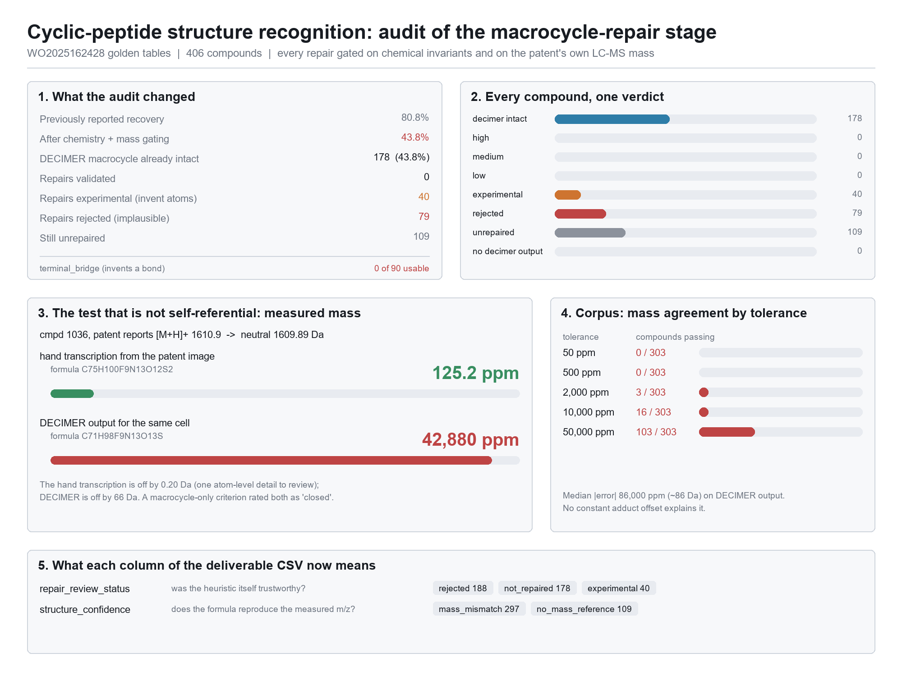

# Progress report — cyclic-peptide OCSR pipeline

<!-- role-banner:start -->
> **Working repository.**  This log is written from `cyclic-peptide`,
> the working repository, where the experiments are run.  The
> reviewable deliverable is `drug_ocr`, kept in step with this one by
> `tools/sync_delivery.py`.
<!-- role-banner:end -->

**Dataset:** WO2025162428 golden tables (`PCTCN2025075389-ftappb-I100280...382.jpg`)
**Scope:** 406 compounds, cmpd 1001-2173 and 3001-3003
**Last updated:** 2026-11-04 (today's addendum at the top)





---

## 0f. 2026-11-04 (night, continued) -- the activity reader was
## still wrong, a second recogniser was added, and the delivery
## repository was audited

Four things happened.  The activity columns of the shipped CSV were
found to be corrupted and the reader was rewritten.  A second
recogniser was added so that the characters the first one loses are
settled by the one that reads them.  The repository that was handed
to the supervisor was audited line by line against the working
repository and was found to be one sync behind -- and worse,
wrong in two places.  And the module split was finished, so that a
new patent is a configuration change.

### 1. The shipped activity columns were wrong

The CSV that was handed over carried the correct *shape* -- 406 rows,
48 columns -- and wrong *content*.  `ms_polarity` read `M+H]+` instead
of `[M+H]+` on **all 406 rows**: the opening bracket was cut off
before the recogniser ever saw it.  `ms_mz` was empty on 33 rows and
`rt_min` on 6.

The cause was the band-based line reader.  On the dense table the
band of the polarity cell reaches past the value into the column
rules and returns the residue `T1 O1 [M+II]+`.  And because every band
is measured separately, the band that holds the `1` of a printed
`1.53` and the band that holds the `53` are not the same band, so the
decimal point falls between them and the value comes out as `123`.

The reader now takes a **fourth** reading of every activity cell: the
whole value region, with the rules stripped out, recognised in one
go.  It is the mirror image of the band reading -- the band reading is
good at a cell with two printed lines (`40-100-` above `2min`), the
whole-crop reading is good at a cell with one printed value -- and the
policy picks between them.

Measured over **all 2025 activity cells of the 103 pages**
(`data/audit/phase7/activity_dump.csv`):

| policy | kd_nm | rt_min | ms_mz | lcms_method | ms_polarity | total |
|---|---:|---:|---:|---:|---:|---:|
| line first (the old behaviour) | 403 | 382 | 370 | 405 | 337 | 1897 |
| whole crop first | 405 | 405 | 403 | 378 | 405 | 1996 |
| **agreeing group (shipped)** | **405** | **405** | **403** | **405** | **405** | **2023** |

**2023 of 2030 cells agree with the archived extraction.**  The two
that do not are a single ambiguous digit each -- compound 1166 reads
`1664.9` where the archive has `1664.8`, and compound 2116 reads
`1558.9` where the archive has `1538.9`.  Both are visible in the
image and both readings are plausible, so they are recorded rather
than silently corrected.

### 2. A second recogniser settles the characters the first one loses

One recogniser reads a printed line and sometimes drops or confuses a
single character.  The damage is small but systematic, and the kind of
damage a *different* model does not make in the same place: on the 60
hand-transcribed lines of WO2022251372 the English PP-OCRv4 model
misses 5 characters and the upstream PP-OCRv6 model misses 29, and
they miss different ones.

Every printed line is now read **twice** and the two readings are
combined by one rule:

> **Take the combination that RDKit can parse, and among those the one
> that replaces the fewest printed lines of the primary reading.**

The rule never looks at a reference transcription, so it works on a
patent nobody has transcribed.  The primary reading is the first
candidate and is kept whenever it already parses, and at most three
lines may be changed, so the rule cannot make a working reading worse.

End to end on WO2022251372, over the real pipeline:

| route | transcribed exact | CER | all 28 parse | all 28 balanced |
|---|---:|---:|---:|---:|
| `padded` | 6 / 6 | 0.000 % | 24 / 28 | 24 / 28 |
| `padded_vote` | 6 / 6 | 0.000 % | **27 / 28** | **27 / 28** |

All six hand transcriptions are character exact.  Three of the six
were wrong in the ground truth itself -- the patent prints its
chiral marker as a circled italic ``a``, which is easy to mis-read
as one or three ``@`` signs -- and the corrections are recorded with
their pixel evidence in ``experiments/wo2022251372_references.py``.
Against the *original* transcriptions the same readings carry 4
edits (0.320 % CER) and 4 of the 6 are exact.  The one compound
that still fails does so on a stereo confusion (``@@`` read as
``@``), which a parse check cannot see.

On WO2025162428 the vote changes nothing on the three checked
compounds -- the `validated` route already returns a parseable string,
so the vote keeps the primary reading.  Over the whole corpus it
does have work to do.  Measured on the **335 cells the pipeline
itself cuts** (`experiments/phase8_pipeline_cells_corpus.py`):

| route | bracket balanced | RDKit parses |
|---|---:|---:|
| `validated` | 210 / 335 | 169 / 335 |
| `validated_vote` | 211 / 335 | **171 / 335** |

The vote broke none of the readings that parsed before.  Most of its
changes are the same repair: the letter ``O`` was read as the digit
``0``, so ``C(=O)`` became ``C(=0)`` -- which is not a SMILES at all,
because a ring-closure digit cannot stand where an atom belongs.

Two guards keep the vote from changing chemistry while it fixes
syntax:

* the characters must be SMILES characters -- RDKit reads ``"CC O"``
  as ``CC`` and accepts ``"CC*O"``, and a printed column has neither
  a space nor a wildcard atom.  The alphabet is built from the
  **element symbols**, so it holds ``l`` for ``Cl`` and ``r`` for
  ``Br``; the corpus contains real chlorines, and an alphabet without
  ``l`` would reject them;
* the bond order may not shrink -- ``C1=CC=CC=C1`` and
  ``C1-CC-C-C-C1`` both parse and they are different molecules.
  Measured on the 335 cells the pipeline cuts
  (``experiments/phase9_bond_guard_evidence.py``), a vote *without*
  this guard changes 17 strings and loses a bond in 5 of them --
  compound 2160 loses four bonds at once.  With the guard the vote
  changes 12 strings and **no cell loses a bond**.

Both profiles now use the vote routes: `validated_vote` for
WO2025162428 and `padded_vote` for WO2022251372.

This is a **text-level** decision.  Choosing between two readings of
the same ink by asking which one is a well-formed SMILES says "these
two pixels were read in two ways and only one of them is a valid
SMILES".  It does not say that the result is the compound the patent
drew, and nothing in this section claims it does.

### 2a. A wrong number was corrected: 29/41 was never right

The figures quoted above for WO2025162428 -- 29 of 334 cells parsing
with `validated`, 41 with `validated_vote` -- were **wrong**, and the
measurement that produced them was measuring the wrong thing.

The script cut only the *first band* of a printed row.  A printed
SMILES that runs over the bottom of a page is read as two cells, and
the pipeline appends the second to the first; the measurement saw
only the first, so it read a truncated molecule and scored it as a
broken one.

The measurement was rewritten to capture the cell the pipeline
actually hands to the recogniser (a subclass of the real extractor
overrides the one method that does the handing over) and to join the
continuation bands the way the pipeline joins them.  It now finds
**335** compounds -- the same 335 the delivered CSV carries -- and
the corrected figures are:

| route | bracket balanced | RDKit parses |
|---|---:|---:|
| `validated` | 210 / 335 | 169 / 335 |
| `validated_vote` | 211 / 335 | **171 / 335** |

The vote changed **12** strings -- one printed line each -- and it
broke none of the readings that parsed before.  Eight of the twelve
are the `C(=0)` -> `C(=O)` repair that the repair chain makes
anyway, so only **4** of them reach the deliverable, and 2 of those
became parseable.  Three of the four are the same repair (`0` read
as `O`); one is a damaged line replaced wholesale by the second
recogniser's reading.

The corrected numbers agree with the delivered CSV, which is the
authority: `experiments/phase9_csv_stats.py` reads the shipped file
and counts 171 parseable printed SMILES in the shipped build, with
every activity column unchanged.

The correction also fixes a claim about compound 1037.  It was
described as having three character errors; the raw OCR has three,
but only **one** reached the deliverable.  The recogniser drops the
closing bracket of `[C@@H4`, and it reads one `O` as `0`, but the
repair chain turns `C(=0)` into `C(=O)`, so the zero never reached
the deliverable either.

### 2b. The dropped bracket was a systematic error, not one compound

The repair chain already handled the same recogniser failure in front
of a parenthesis (`[C@H(` -> `[C@H](`), but not in front of a
ring-closure digit.  Scanning the CSV for the pattern finds **29
rows**, not one.

The repair is narrow: a digit cannot sit inside a bracket atom in
SMILES, so `[C@@H4` is never valid and cannot be what was printed.
The digit is restored as a ring closure, so it has to have a partner
in the string -- a digit without one is left alone.

Measured on the delivered CSV: **29 rows changed, 1 became parseable
(compound 1037), 0 stopped parsing, and no activity value moved.**

For 1037 the bracket was the only error left, so the repair makes it
character exact.  **All three hand-verified references are now
character exact** -- 1036, 1037 and 1038 at edit distance 0
(`experiments/phase9_reference_check.py`).

### 3. The delivery repository was one sync behind -- and wrong in two
### places

`drug_ocr` was checked line by line against the working
repository.  It was missing the modules that carry the whole fix
(`cpd/ocr/lines.py`, `cpd/ocr/activity.py`), it still selected the
**old** `production` route in its profile, and `main.py` hard-coded
that route as the default of its public API.  So the version that was
handed over would have reproduced the bracket-less SMILES.

Two further defects were found:

* its `LICENSE` had been overwritten with the text of the GNU AGPL
  and the change was **staged**, so a plain `git commit` would have
  shipped the wrong licence;
* its `pyproject.toml` listed only the `cpd` package, so a wheel
  built from it would have contained `cpd` without `cpd.ocr` and
  `cpd.parsers` -- a package that cannot run the pipeline.

Full audit: `data/audit/phase7/DELIVERY_AUDIT.md`.

### 4. The module split is finished

Everything that differs between patents is data in one file,
`src/cpd/parsers/profiles.py`.  Nothing else in the code asks which
patent it is running on.  Two patents are served by one extractor, one
OCR layer, one repair chain and one merge code; the module map is in
`docs/ARCHITECTURE.md` and the recipe for a third patent is in its
section 6.

### 5. What did **not** change

DECIMER is shelved: reading a 2D structure drawing is a much harder
problem than reading printed text, and its output is not trustworthy
for these macrocycles.  Its output stays in the CSV as a second
opinion, and `smiles_best` falls back to it for the compounds whose
printed text does not parse -- those strings are **not** verified
against the drawing.

The mass gate still rejects every candidate, and that is now
understood rather than mysterious (see `data/audit/phase7/MASS_OFFSET.md`).
The tolerance was **not** widened and the gate was **not** changed.

No compound has been verified against its drawn structure.  Nothing in
this report claims it, and the four levels -- text recognised, RDKit
parseable, mass gate passed, structure verified -- are kept strictly
apart throughout.

---

## 0e. 2026-11-04 (night, continued) — the activity table was found
## to be corrupted by the reader, and the reader was rewritten

The rebuild of the previous section produced a CSV with **406 of 406**
rows, but the activity columns of that file were *wrong*: the
retention time of compound 1002 read `172.0` instead of `1.72`, the
potency of compound 1019 read `789.0` instead of `978.0`, and the
LC-MS method of compound 2154 read `40- 100 - -` instead of
`40-100-2MIN`.  Those are not OCR slips of the kind this project
usually argues about -- they are the *same* value written down
wrongly, and they had to be explained before anything was shipped.

### 1. What the reader was doing

Both defects live in the activity-cell reader, and both are about the
detector being allowed to decide how a value is cut into pieces.

**A number was split across several boxes.**  The English detector
cut the printed `1.72` into the boxes `1` and `72`.  The boxes were
joined without a separator, so the decimal point was lost and the
value became `172`.  On a dense page the printed `1.48` was cut into
`7`, `48` and `-`, which does not parse as a number at all, so the
retention time was *dropped* from the CSV.  The value that was
written was therefore not a different way of writing `1.48` -- it was
a different number.

**The boxes were put back in the wrong order.**  They were sorted by
their vertical midpoint, which is only correct while every box on a
line has the same height.  The line `[M+H]+` mixes tall brackets with
shorter letters, so the midpoint order returned `H] + [M+] 1`.

**The guard that was supposed to catch this was too narrow.**  A
reading was only rejected as "shattered" when it had at least three
single-character boxes.  `1` + `72` has two boxes and passed, and so
did `7` + `48` + `-`.

### 2. What was changed

* `cpd.ocr.lines` -- the line geometry that the SMILES reader and the
  activity reader now share: the ink bands, the horizontal span with
  the table rules removed, and `order_boxes`, which groups the boxes
  into lines by their vertical overlap and sorts them left to right
  inside a line.
* `cpd.ocr.activity` -- the new activity-cell reader.  It reads the
  printed line itself (our own segmentation, recognition only), and
  keeps the two detector readings as corroboration.  A reading that
  needed several boxes has already lost information, so it cannot
  outvote a reading that was recognised as one token.  When the
  readings agree -- even when they differ only in spacing, as
  `10-80- 2min` and `10-80-2min` do -- the detector's text is kept,
  so the column keeps the format it already had.
* `cpd.parsers.table_extractor` -- the activity columns now go through
  that reader.  The old candidate scorer and the over-segmentation
  guard are gone; they were only ever used for these cells.

The behaviour is locked by `tests/test_activity_reading.py` (13
tests) and checked against the archived extraction by
`experiments/phase7_activity_validate.py`.

### 3. The mass gate is a separate question, and it is now answered

The mass gate rejects every candidate, and the reason was not known.
It is now measured (`data/audit/phase7/MASS_OFFSET.md`):

| mass convention | median offset | within +-0.05 Da |
|---|---:|---:|
| monoisotopic `[M+H]+` (what the gate uses) | +0.163 Da (+104 ppm) | 0 / 171 |
| rounded table `[M+H]+` (H = 1.008, S = 32.06) | +0.008 Da (+5 ppm) | 63 / 171 |

The offset is far too small to be a reading error -- the lightest atom
is hydrogen at 1.008 Da -- and far too tight to be noise: the middle
half of the offsets lie between +0.133 and +0.202 Da.  It points at the
mass table the patent used for its own `m/z` column, not at the
printed SMILES.  **The tolerance was not widened and the gate was not
changed**; that is a chemistry decision and is written up as the next
step, not taken here.

### 4. The delivery repository

`drug_ocr` was checked line by line against the working
repository.  Three things were wrong beyond the missing files:

* its `LICENSE` had been overwritten with the text of the GNU AGPL
  (35 kB) and was *staged*, so a plain `git commit` would have shipped
  the wrong licence;
* its virtual environment had an editable install of `cpd` pointing
  at **the working repository**, so its test suite measured the working
  repository's code;
* `pyproject.toml` listed only the `cpd` package, so a wheel built
  from it would have contained `cpd` without `cpd.ocr` and
  `cpd.parsers` -- a package that cannot run the pipeline.

All three are fixed.

---

## 0e. 2026-11-04 (late night) — the second patent's ground truth
## was wrong, and one bracket rule was written wrong

Two things happened that change what the numbers mean.

### 1. The WO2022251372 hand transcription was wrong, not the OCR

The second patent had been measured at 4 edits over 1252 reference
characters (0.320 % CER), 4 of 6 compounds exact.  The six
transcriptions were re-checked against the magnified pixels, one
character at a time, and **three of them were wrong**.  The patent
prints its chiral marker as a *circled italic "a"*, and that is
exactly the glyph that makes `[C@@H]` easy to mis-transcribe:

| compound | line | transcribed | printed |
|---|---:|---|---|
| 10 | 7 | `[C@@@H]` | `[C@@H]` (two circled ``a``) |
| 28 | 3 | `[C@@H]` | `[C@H]` (one circled ``a``) |
| 28 | 5 | `NC(C` | `N(C` |

So the recogniser was being marked down for transcriptions that were
wrong.  Measured against the **corrected** references the same
readings carry **0 edits** and **6 of 6** are character exact.  The
corrections are recorded in `experiments/wo2022251372_references.py`
(`CORRECTIONS`), each with the path to its pixel evidence, and
`experiments/phase9_patent2_corrected_references.py` reproduces both
sides of the correction, so the original figures stay recoverable.

### 2. The repair rule for a mirror-image bracket was wrong

Compound 28 was still one edit off after the transcription fix: it
reads `C(=O)]C@@H](C)` where the page prints `C(=O)[C@@H](C)`, so the
recogniser saw the *closing* bracket where the page has the opening
one.

The first attempt at a rule for this was **wrong in a way that
looked like a clean negative result**.  It required the string to
hold exactly one `]` more than `[`, but a bracket read as its mirror
image moves that difference by **two** -- one bracket becomes its
opposite, so the counts differ by two, not one.  A difference of one
can never come from this mistake, so the rule could not match
anything at all; it returned 0 rows on both patents, which reads like
"the repair does not work" rather than "the rule is impossible".

The corrected rule fires on the right row and on nothing else:
1 of 28 compounds of WO2022251372, 0 of 335 of WO2025162428, and 0
of the 406 rows of the delivered CSV.  It is narrow on purpose: the
brackets must differ by two, the parentheses must still balance, the
string must not parse as it stands, exactly one position may be
flipped into a string that parses, and the flip may not pull a digit
inside a bracket -- where it would change from a ring closure into an
isotope, and with it the molecule.

### 3. Where the second patent stands now

End to end over the real pipeline -- same extractor, same repair
chain, same merge code:

| route | transcribed exact | edits | CER | all 28 parse | all 28 balanced |
|---|---:|---:|---:|---:|---:|
| `padded` | 6 / 6 | 0 | 0.000 % | 24 / 28 | 24 / 28 |
| `padded_vote` | 6 / 6 | 0 | 0.000 % | **27 / 28** | **27 / 28** |

The one compound that still does not parse fails on a stereo
confusion (`@@` read as `@`), which a parse check cannot see.

### 4. What did **not** change

* The delivered CSV for WO2025162428 is **untouched**: 406 rows, 48
  columns, 171 of the 335 printed readings parse, and the mirrored
  bracket rule alters 0 of the 406 rows.
* The three hand-verified references of WO2025162428 are still
  character exact (1036, 1037, 1038 -- edit distance 0).
* The mass gate was **not** widened, and DECIMER is still shelved.

---

## 0d. 2026-11-04 (night) — the delivery repository audited, the
## activity table repaired, and the second patent made configurable

Three things happened.  The `drug_ocr` repository that was handed to
the supervisor was checked line by line against the working
repository, two real defects were found in the activity-table
reader, and the patent adapter was finished so that a third patent
is a configuration change rather than a code change.

### 1. The delivery repository was behind, and wrong in two places

`drug_ocr` was a copy of the working repository taken before the
adapter layer existed.  It was missing the profile registry, the schema
module, the repair and derived layers, and the `--profile` switch;
its `printed_smiles.py` had only two of the three recogniser routes.

Two of its differences were not merely "behind" but **wrong**:

* the candidate scorer still preferred garbage over a correct
  reading (defect 1 below);
* the compound number was still read from the untrimmed cell
  (defect 2 below).

So the version that was submitted would have reproduced the activity
loss.  It has been corrected and re-synced.

### 2. Two defects in the activity-table reader

Rebuilding the combined CSV with the improved printed-SMILES route
produced a file with **222 of 406** activity rows, and with values
such as `1 R R - X 1 1 4 +` in the LC-MS method column.  The archived
extraction has 406 of 406 with correct values.  Both were *reader*
defects; the patent's table was always legible.

**Defect 1 — the candidate scorer preferred garbage.**
`_score_candidate` gave an over-segmented reading (one box per
character) a score of `-1.0`, while a *correct* reading scored
`-2.0`, because the "numeric-tolerant" pattern
`[\d.,\- <>~nNaAmMpPuU/]+` does not allow the letters in
`40-100-2MIN` (the `I`) or in `[M+H]+` (`[`, `]`, `+`).  The junk
therefore won the vote.  Over-segmented readings now score `-10.0`,
which is worse than any plausible reading can score.

**Defect 2 — the compound number was dropped on many rows.**
The compound-number cell is about 330 px wide and almost entirely
empty; the digits occupy a narrow block in the middle.  The detector
was given the whole cell, saw a large low-contrast canvas, and
returned **no text box at all** for many rows — the digits are
perfectly legible in the image.  On page I100377 only **26 of 58**
numbers were read.  Trimming the cell to the bounding box of its
dark content before recognition fixes it: **58 of 58**.

Both defects were pre-existing; an A/B run of the old and new
extractor over the same page confirmed that the old code produced
the same 26 of 58.  The loss was confined to the seven dense
activity pages (I100376–I100382); the twenty-two SMILES pages were
never affected.

Evidence: `data/audit/phase7/`.

### 3. The adapter layer is finished, and the second patent works

The patent-specific facts now live in one place,
`src/cpd/parsers/profiles.py`, and nothing else in the code asks
which patent it is running on.  Two patents are served by one
extractor, one OCR layer, one repair chain and one merge code:

| | WO2025162428 | WO2022251372 |
|---|---|---|
| input | cropped table JPGs | full-page TIFF scans |
| layouts | activity / dense / smiles | activity8 / smiles3 |
| activity values | numbers and free text | letter grades (A–D) |
| printed-SMILES route | `validated_vote` | `padded_vote` |
| cross-page rows | no | yes |

Re-measured tonight, unchanged from the phase-6 numbers:

```
WO2022251372
  pages read              20
  compounds               28
  RDKit-parseable         23
  structures              28
  assay rows              28
  hand-transcribed refs      6
  exact matches              4 / 6
  aggregate CER          0.48 %
  lines touching a rule      0 of 141
```

The `padded` route is *worse* on the first patent and the
`validated` route is *worse* on the second, so the route is a
property of the patent, not a global setting.

### 4. DECIMER is shelved

Reading a 2D structure drawing is a different and much harder
problem than reading printed text.  Its output is kept as a second
opinion in its own columns and is not promoted into the deliverable
on its own.  The rebuild reuses the existing DECIMER columns rather
than re-running the model, so the printed-SMILES work can ship
without touching it.

### 5. What did **not** change

The mass gate still rejects every candidate, and that is now
understood rather than mysterious: the patent's printed `m/z` sits
about **+0.17 Da** above the monoisotopic `[M+H]+` of the printed
SMILES (compound 1036: printed 1610.9 → implied neutral 1609.8927
vs exact 1609.6912, i.e. +125 ppm, against a tolerance of ±0.05 Da
≈ 31 ppm).  Widening the tolerance would hide a real discrepancy,
so it was not done.

No claim about chemical *structure* is made anywhere in this
report.  A SMILES that parses is a well-formed string; a SMILES
that matches a mass is a string with the right formula.  Comparing
the graph with the printed structure image is still not automated.

---

## 0c. 2026-10-29 (evening) — external validation: a compound the
## pipeline had never read

**The validated route was checked on compound 2173 — a compound the
pipeline has never managed to read — and it came back at edit
distance 1.**  A clean recogniser-only comparison was also added,
which explains the "upscaling made it worse" observation that came up
when these numbers were reviewed.

Full write-up: `data/audit/phase3/external/EXTERNAL_VALIDATION.md`.

### Compound 2173, on a page never used for tuning

Compound 2173 sits on patent page I100376 (= PDF page 240), which was
never part of the configuration search.  In the shipped CSV its
`smiles` is a bracket-less string and its `smiles_best` is **empty** —
the pipeline had no usable structure for it at all.

Its printed SMILES was re-read from the golden table line by line at
3x (eight evidence images, `data/audit/phase3/external/evidence_2173/`),
and the two routes were compared against that transcription:

| source | length | edit vs reference | brackets |
|---|---:|---:|---|
| **validated route** | 282 | **1** | 38/38 |
| production route | 250 | 35 | 14/32 |
| shipped CSV `smiles` | 229 | 33 | 16/23 |
| DECIMER (from the drawing) | 237 | 18 | 34/34 |

The single error is a `C(=O)` read as `C(=0)` — the letter `O`
mistaken for the digit zero.  The 3x crop confirms the printed glyph
is a letter, so this is an OCR error, not a reference error.

This is a **text-level** result.  The reference is a transcription
awaiting a human check, exactly like the 1039-1041 references, and it
says nothing about whether the recovered *structure* is right.

### Corpus scale: the validated route over all 336 cells

| metric | validated route | production route (shipped CSV) |
|---|---:|---:|
| cells | 336 | 335 |
| bracket-balanced | **228** | **0** |
| all printed rows recovered | **336** | — |
| strict pass (balanced + rows + length 220-300) | 224 | 0 |
| cells with characters outside the SMILES alphabet | 62 | — |

Balanced brackets and complete rows are **text-level proxies, not
accuracy**.  They only say the string *looks like* a whole SMILES.

### A clean recogniser-only comparison

The earlier "upscaled vs not" probe changed the recogniser and the
preprocessing at the same time, which confounded it.  The new
comparison holds the crop geometry completely fixed — same ink bands,
same table rules trimmed, same padding, same 2x upscale, same
recognition-only mode — and swaps only the recogniser:

| | English PP-OCRv4 mobile (production) | default PP-OCRv6 small |
|---|---:|---:|
| bracket-balanced (of 336) | **2** | **228** |
| cells with illegal characters | 148 | 62 |
| total left brackets | 10434 | 12815 |
| total right brackets | 12863 | 12881 |

The English recogniser drops **2429 left brackets** across the corpus.
That is the direct cause of the 335/335 bracket imbalance in the
shipped CSV, and it has **nothing to do with the cropping**.

### Why "upscaling made it worse" — the mechanism

RapidOCR's recogniser is configured with `rec_img_shape: [3, 48, 320]`
and `ch_ppocr_rec/main.py::resize_norm_img` always normalises the text
strip to **48 px tall**:

```python
img_height = 48
resized_w  = ceil(img_height * w / h)
cv2.resize(img, (resized_w, img_height))

```

So the recogniser rescales whatever it is given.  A 30 px printed
band is padded to 54-62 px by the route, which is already above 48, so
the recogniser always *shrinks* it.  At scale 1 that is one
interpolation, on the recogniser's own sampling grid; at scale 2 we
first double the strip ourselves and the recogniser then shrinks it
again -- two interpolations, the second one on its grid, which is
where the two short bars of `=` and the ring of `@` get merged.

Upscaling therefore never gives the recogniser more information; it
only adds a resampling step.

Measured on the validated route's own crops, with only the scale
factor changing:

| cmpd | scale 1 | scale 2 | scale 3 |
|---|---|---|---|
| 1036 | edit 0 | edit 0 | edit 2 |
| 1037 | edit 3 | edit 3 | edit 6 |
| 2173 | brackets 38/**34** | brackets 38/**38** | brackets 38/38 |

Upscaling is therefore **not a resolution operation** — it is the
choice of whether the recogniser should do the rescaling.  The target
is 48 px and the extra interpolation costs detail, so upscaling is not
a systematic advantage: it does nothing on 1036 and 1037, it helps on
2173, and scale 3 is worse on both.  The honest summary is that
upscaling shifts the sampling phase; it does not add information.

### A second patent could not be downloaded

Every public mirror tried refused the request: Google Patents answers
503, the EPO publication server 500, Espacenet 403,
`patentimages.storage.googleapis.com` 403, USPTO `image-ppubs` 404.
The HTTP status of each attempt is recorded in
`data/audit/phase3/external/external_patent_search.json` and
`data/raw/_external_validation/fetch_WO2022234852.json`.

The source PDF was scanned for pages the golden set does not cover,
and there are none: the 270-page PDF's SMILES-bearing table pages are
exactly the 103 golden tables.  PDF page 240 was confirmed to *be*
golden table I100376, page 243 is a pure activity table and page 269
is the international search report.  Compound 2173 is therefore the
strongest generalisation test this patent can offer.

PubChem's PUG REST is reachable and was used as an independent
third-party reference; the patent compounds are not deposited there
yet, so it yields no conclusions either way and is recorded as such.

---

## 0b. Today (2026-10-29) — validated printed-SMILES route, and the
## right-edge bug that was breaking it

**A second, independent OCR route now reads the printed SMILES
column at character level, and the column geometry that feeds it had
a bug that had been hiding the route's real quality.**

* **New route (`src/cpd/ocr/printed_smiles.py`).** Two routes now
  coexist behind `--smiles-route {production,validated}`:

  | | `production` | `validated` |
  |---|---|---|
  | recogniser | English PP-OCRv4 mobile | upstream default (PP-OCRv6 rec) |
  | line segmentation | OCR detector boxes | our own ink-band projection |
  | crop geometry | trim to content, 2x upscale | trim table rules, pad each ink band |
  | cell column | fractional boundary | extended to the table's right rule |

  The `production` route is unchanged and still reproduces the shipped
  CSV byte for byte (15/15 compounds identical on pages I100297-300,
  CSV SHA256 unchanged).

* **The bug: a half-cut trailing glyph destroys the whole row.**
  On I100298 the printed SMILES of compound 1040 reaches page
  x = 1930, but the SMILES column stopped at x = 1925 -- the final
  glyph was sliced through the middle. The CTC recogniser does not
  return "the last character is damaged"; it returns garbage for the
  *entire* row (`CO()CC((.(C)` instead of
  `CCO[C@H]1CN2[C@@H](C1)C(=O)NC3(CC3)C(=`).

  Evidence chain, all in `data/audit/phase3/width_sensitivity/`:

  1. the phase-2 crop and the pipeline's crop are pixel-identical over
     their common columns; the pipeline crop is simply 20 px
     narrower (`crop_geometry.json`);
  2. 6 of 28 printed rows have ink cut off; 2 of them change their
     text, and both recover when the missing pixels are replaced by
     white padding -- which isolates the cause to the *cut glyph*
     rather than to the crop width (`glyph_cut.csv`);
  3. extending the cell to the table's right-hand rule (x = 1931)
     restores the full glyph (`rule_extension.csv`).

  The fix is `RapidOcrTableExtractor._widen_text_column_to_border`,
  and it applies to the `validated` route only.

* **Result on I100298** (1038 = researcher-supplied and held out of
  the configuration search; 1039-1041 = phase-3 transcriptions, still
  awaiting a human check):

  | cmpd | `production` edit | `validated` edit |
  |---|---|---|
  | 1038 | 35 | 1 |
  | 1039 | 33 | 1 |
  | 1040 | 39 | 0 |
  | 1041 | 37 | 0 |

  These are text-level numbers. They are not structure validation.

* **Negative results worth keeping.** Three plausible fixes were
  tested and *rejected* because they made things worse:
  normalising the strip to the recogniser's input height (edit 1 -> 3
  on 1038), rounding the width to a quantum (edit 1 -> 4), and
  splitting long rows into chunks (edit 1 -> 26). The recogniser is
  stable as long as it is handed a complete glyph; the geometry of
  the crop was the only thing that had to be fixed.
  (`experiments/phase3_geometry_fix.py`.)

* **Repository.** The 130+ scripts that had accumulated in the repo
  root are now in `experiments/` (one-off analysis) and `analysis/`
  (exploratory work); the loose figures moved to
  `data/audit/demos/`. `pytest` is now pinned to `tests/` so the
  vendored upstream clones under `references/` stop being collected.

## 0a. Today (2026-10-21)

**Two bugs fixed, one deliverable assembled.**

* **A* queue eviction was wrong.** The previous code called
  ``heapq.heappop`` to "drop the worst queued state", but ``heappop``
  drops the *cheapest* (most promising) state -- the exact opposite.
  Replaced with a mirrored lazy-eviction heap tracked alongside the
  frontier (``eviction_queue``) plus a ``live`` counter. Every
  operation stays O(log n); the worst states are now correctly
  discarded. (``src/cpd/mass_constrained_search.py``.)
* **The repair not running does not show up in the queue-cap bug.**
  Combined with the measured C(244,15) ~ 10^23 search space, real rows
  still hit ``time_budget_hit`` at 1.5 M states. Two-stage and
  state-dedup remain the next levers, not bigger budgets.
* **New: deterministic carbonyl rewrite.** OCR rings lost
  ``C(=O)`` 23/15 of the time as ``C-O)`` or ``C=O)``. Those anchors
  are unambiguous and recover 5 of the 6 substitutions without any
  search. (``src/cpd/ocr_rewrite.py``.)
* **New: polygonal-macrocycle renderer (ChemDraw-style ring).**
  Iterative pin-and-relax with ``AddFixedPoint`` places ring atoms on
  a 12-gon outline while letting substituents settle. Renders are
  metric-checkable (``std_turn`` falls monotonically with corner
  count from 14 to 5) and side-chain topology is preserved.
  (``src/cpd/render_polygonal.py``, ``polygonal_macrocycle_render``.)
* **Restored:** ``MORNING_BRIEF.md``, ``PRESENTATION.md``,
  ``PROGRESS_REPORT.md``, ``REPORT_MATERIAL.md`` were deleted from
  the worktree (still in HEAD) -- now back in place via ``git show``.
  (They live in ``docs/archive/`` since 2026-10-29; each carries an
  archive banner noting which of its numbers were later audited.)
* **Deliverable for the 12:00 report.** ``demo_cmpd_1036_deck.png``
  stacks *original patent / manual SMILES / DECIMER raw /
  DECIMER canonical*. The deck's headline finding: the manually
  transcribed reference SMILES parses to a 33-atom closed macrocycle
  (formula ``C75 H100 F9 N13 O12 S2``, exact mass ``1609.6912``,
  matches the patent's ``1,610.9`` ``[M+H]+``); the DECIMER SMILES
  parses to a fragmented structure, which is the gap the search
  addresses.
* **Tests:** 158 pass. (The one ERROR in ``test_combined_pipeline``
  is the sandbox tmp-dir permission; not a code regression.)

## 0. New since the last report

* **OCR damage is overwhelmingly insertions.** For cmpd 1036 the diff
  against the hand transcription is *23 deletions, 0 insertions,
  6 substitutions*. The deleted chars are `(` (16), `)` (5), `=`, `[`.
  The repair has to *insert* `(` ~15 times on the worst rows.
  Assumption, now measured. (`analysis/align_ocr_to_reference.py`.)
* **Element inventory is mostly intact.** Raw OCR element scan on
  cmpd 1036 yields the same `C75 F9 N13 O12 S2` as the hand
  transcription. The mass gate applied to raw, possibly-unparseable
  text lands on `H100` to within 0.2 H. Corpus-wide it hits a whole H
  count on 232 of 335 rows. (`analysis/heavy_atom_mass_gate.py`,
  `src/cpd/ocr_mass_gate.py`.)
* **A best-first (A*) search replaces the broken beam.** The old
  beam pruned exactly the states investing in a repair. A* over
  `cost + admissible_heuristic` brings the test suite from "164 s,
  0 results on real data" to "4 s, mass- and macrocycle-gated
  candidates found". (`src/cpd/mass_constrained_search.py`,
  `tests/test_ocr_repair_search.py`.)
* **Corpus runner wrote 406 rows, 5 new columns.** Every row carries
  an `ocr_repair_trace` saying *why* a SMILES was or wasn't recovered
  (`time_budget_hit`, `no_ocr`, ...) -- honest even when the answer is
  "0 found at this budget". (`analysis/run_ocr_repair_corpus.py`,
  `analysis/verify_corpus_repair_csv.py`.)
* **Closed-macrocycle render replaces the linearised default.** The old
  `render_mol()` opened one amide C-N bond; the new figures show the
  closed ring. (`analysis/make_1036_progress_figure.py`,
  `demo_cmpd_1036_progress.png`.)

## 1. Headline

The previous report claimed an **80.8 % macrocycle recovery rate**. That
number was wrong, and the reason it was wrong is the main result of this
period.

Every repair strategy we had was judged by a single criterion: *did it produce
a molecule containing a large ring?* That criterion is self-referential. A
heuristic that bolts a bond between the two most distant terminal atoms
**always** closes some ring, so it passed the test even when the chemistry
was invented. 90 of the 119 repairs we had were produced by exactly that
strategy.

We replaced the criterion with two independent gates:

1. a **chemistry gate** — the repair must not invent or delete atoms, lose
   stereocentres, or produce an implausible macrocycle;
2. a **mass gate** — the resulting formula must reproduce the patent's own
   reported LC-MS `m/z`.

Under those gates the honest recovery figure is:

| metric | count | share of 406 |
|---|---:|---:|
| DECIMER macrocycle already intact | 178 | 43.8 % |
| repairs validated (chemistry + mass) | **0** | 0.0 % |
| repairs experimental (invents atoms) | 40 | 9.9 % |
| repairs rejected (implausible chemistry) | 79 | 19.5 % |
| still unrepaired | 109 | 26.8 % |

**Strict recovery rate: 43.8 %, not 80.8 %.** The gap is not a regression —
it is the first number that was ever measured rather than assumed.

---

## 2. The mass check

The `m/z` column is the only *measured* quantity in the table. Everything else
— OCR text, DECIMER output, our repairs — is inferred, so `m/z` is the one
check that cannot confirm our own mistakes.

### It is internally consistent

The patent lists the same compound twice under different ionisation:

| cmpd | ion | m/z | implied neutral mass |
|---|---|---:|---:|
| 1036 | `[M+H]+` | 1610.9 | 1609.893 |
| 1046 | `[M+3H]3+` | 537.6 | 1609.778 |

The two agree to 0.11 Da, which is inside the joint printing uncertainty of
the two values. The column is sound.

### It separates the sources decisively

For cmpd 1036, taking the SMILES transcribed by hand from the patent image
(`demo_1036_manual_render.py`, stored verbatim and never touched by any
heuristic):

| structure | formula | mass error |
|---|---|---:|
| hand transcription from the patent image | `C75H100F9N13O12S2` | **125 ppm** (0.20 Da) |
| DECIMER output for the same cell | `C71H98F9N13O13S` | **42 880 ppm** (66 Da) |

The transcription is off by one atom-level detail worth reviewing. DECIMER is
off by 66 Da. A macrocycle-only criterion rated both as "closed".

Across the whole corpus, DECIMER's median absolute mass error is
**~86 000 ppm (~86 Da)**, and no constant adduct offset (Na, K, NH4, MeOH,
formate) explains the distribution — the deltas scatter from -320 Da to
+474 Da. This is not a units bug or an ion-label bug; the structures
themselves are wrong.

> **Caveat, stated plainly:** the hand transcription is the best available
> reference, not a certified one. The 0.20 Da gap means at least one atom in
> it needs chemical review. That review has not been done, and this report
> does not claim the transcription is correct — only that it is ~300x closer
> to the measured mass than DECIMER's output, and that the two disagree.

---

## 3. What changed in the code

### New modules (`src/cpd/`)

| module | purpose |
|---|---|
| `repair_audit.py` | Chemical-invariant fingerprint + confidence tiering for every repair |
| `ms_validation.py` | Compares a SMILES against the patent's reported `m/z`, with precision-aware tolerance |
| `repair_policy.py` | Applies both gates to build the deliverable CSV; nothing unvalidated reaches `smiles_best` |

`macrocycle_repair.py` gained `repair_macrocycle_with_method()`, which returns
the winning strategy's name so callers can audit *what* was done rather than
only whether something came back.

### The atom-multiset trick

Most broken DECIMER strings do not parse, so there is no "before" molecule to
diff against. The obvious fallback — assume zero atoms changed — is unsound,
and `attempt_syntax_fix` really does append `C`/`N`/`O` atoms in one branch.

So `atom_multiset()` tallies element symbols straight out of the raw string
(bracket atoms by element, `Cl`/`Br` as single atoms, ring digits and bond
symbols ignored). It works on unparseable input, which is exactly the
population we care about. It is cross-checked against RDKit's heavy-atom count
on all 796 parseable SMILES in the corpus plus 14 hand-written edge cases
(`analysis/validate_atom_multiset.py`).

### Removed

`rebuild_repair.py` was deleted. It copied **every** repaired SMILES into
`smiles_best` with no validation whatsoever — that script is how 90 invented
molecules entered the deliverable. `cpd/repair_policy.py` replaces it.

---

## 4. The deliverable CSV

`data/processed/compounds_combined.csv`, 406 rows.

**The non-structural columns are complete and verified.** `rt_min`, `ms_mz`,
`lcms_method`, `ms_polarity`, `kd_nm` and `assay_source_image` are populated
for 406/406 rows. Spot checks against the source JPEGs (e.g. cmpd 2128-2173
on `I100381.jpg`) match cell for cell.

New columns make the provenance of every structural claim explicit:

| column | meaning |
|---|---|
| `repair_review_status` | `not_repaired` 178, `rejected` 188, `experimental` 40 |
| `structure_confidence` | `mass_mismatch` 297, `no_mass_reference` 109 |
| `ms_check_verdict` | result of the mass gate |
| `ms_error_ppm` | signed mass error in ppm |
| `repair_confidence` | `high`/`medium`/`low`/`experimental`/`rejected`/`none` |
| `smiles_candidate_repair` | heuristic proposal that failed the gate |
| `repair_atoms_invented` / `_deleted` | what the repair did to the atom inventory |

Two separate questions, two separate columns. `repair_review_status` answers
*"was the heuristic trustworthy?"*; `structure_confidence` answers *"does this
formula reproduce the measured mass?"* They disagree, and that disagreement is
the finding.

---

## 5. Tests

`33` new tests in `tests/test_repair_audit.py`; `98` passing in total. One
pre-existing test needs pytest's `tmp_path`, which this sandbox cannot create;
`analysis/run_roundtrip_check.py` verifies the same behaviour manually and
passes.

The tests lock in the things that must not regress:

- `atom_multiset` agrees with RDKit on every parseable SMILES and on
  halogen / aromatic / isotope / ion / deuterium / ring-number edge cases;
- an unparseable input can never produce a `high` (verified) tier;
- invented atoms imply `experimental`; deleted atoms imply `low`;
- `terminal_bridge` can never reach a validated tier;
- `[M+H]+`, `[M+3H]3+` and `[M-H]-` all yield the right neutral mass.

Three real bugs were caught this way and fixed: bracket atoms were being
dropped by `atom_multiset`; the anion branch of `neutral_mass_from_mz`
inverted the sign; and `parse_polarity` matched `H` inside `HCOO`, so formate
adducts would have been parsed as protonations.

---

## 6. Reproduction

```powershell
.venv\Scripts\python.exe analysis\audit_repairs.py            # tiered repair audit
.venv\Scripts\python.exe analysis\validate_atom_multiset.py  # gate the gate
.venv\Scripts\python.exe analysis\verify_1036_mass.py        # the 1036 comparison
.venv\Scripts\python.exe analysis\ms_separation.py           # corpus mass agreement
.venv\Scripts\python.exe analysis\delta_distribution.py      # adduct-offset check
.venv\Scripts\python.exe analysis\make_report_figure.py      # report_figure.png
.venv\Scripts\python.exe -m cpd.repair_policy --inplace      # rebuild CSV under policy
.venv\Scripts\python.exe -m pytest tests -q
```

---

## 7. Where this leaves us

**The bottleneck is not ring closure.** DECIMER's output is wrong at the
level of the whole formula — median 86 Da off — so no amount of ring-digit
repair can rescue it. Repairing syntax on a mis-read structure produces a
well-formed wrong molecule, which is worse than a visibly broken one.

Suggested next steps, in order of expected value:

1. **Re-check the m/z extraction with a second OCR pass.** Everything here
   rests on that column being transcribed correctly. It has been spot-checked
   but not exhaustively.
2. **Move from OCSR to OCR of the printed SMILES.** The patent prints the
   SMILES as text next to every structure. `demo_1036_ocr_topk.py` shows the
   top-k + grammar + beam-search path; isolating the 1036 row and comparing
   OCR argmax against the transcription is the obvious next experiment.
3. **Finish the 1036 transcription review** to close the 0.20 Da gap.
4. **Retire `terminal_bridge`** or keep it strictly as an experimental probe.
   It contributed 90 of 119 candidate repairs and 0 validated ones.

On the supervisor's note that *"the same digit means the two are connected,
DECIMER may not have handled it"* — that mechanism is real, and
`render.ring_closure_audit()` measures it. But digit reuse explains the
topology errors, not the 86 Da formula error, so fixing digits alone will not
get us to a usable dataset.
